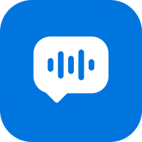
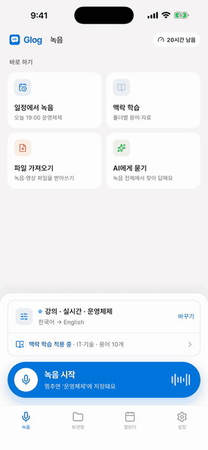
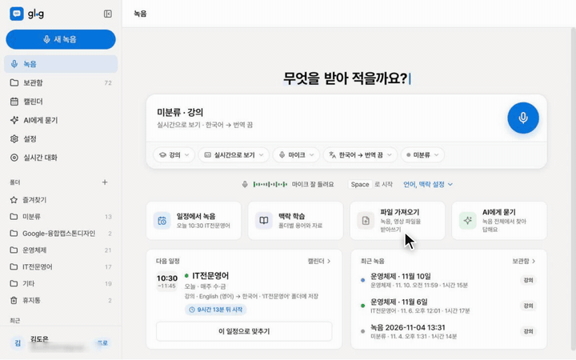

<div align="center">




# 글로그 Glog

말은 글로, 글은 기록으로.<br/>
수업과 회의를 실시간으로 받아쓰고 번역하고, 끝나면 요약까지 정리해 주는 서비스다.

**운영 중, iOS 1.1.0 출시 2026-11-12** &nbsp;|&nbsp; Built with [Flutter](https://flutter.dev), [Flask](https://flask.palletsprojects.com), [Claude](https://www.anthropic.com/claude)

[](https://glognote.com)
[](https://glognote.com)
[](https://glognote.com)

[](https://flutter.dev)
[](https://flask.palletsprojects.com)
[](https://www.anthropic.com/claude)

**[웹 사이트](https://glognote.com)** &nbsp;|&nbsp; **[화면](#화면)** &nbsp;|&nbsp; **[어떻게 쓰나](#어떻게-쓰나)** &nbsp;|&nbsp; **[플랫폼](#플랫폼)**

</div>

## 개요

글로그는 강의와 회의를 실시간으로 받아쓰고 번역하고, 녹음을 멈추면 요약해 주는 서비스다. 필기에 쫓기지 않고 설명과 대화에 집중할 수 있게 하는 것이 목표다. 웹, 휴대폰 웹, iPhone 앱에서 같은 계정과 같은 기록을 쓴다.

- **실시간 받아쓰기.** 말하는 동안 문장이 바로 글로 쌓인다. 놓친 부분은 시간대를 눌러 다시 들을 수 있다.
- **자동 번역.** 문장마다 번역이 바로 아래에 붙는다. 원문과 번역을 나란히 보며 따라갈 수 있다.
- **AI 요약과 묻기.** 녹음을 멈추면 핵심과 결정 사항, 할 일을 정리한다. 내 녹음 전체에 대고 궁금한 것을 물어볼 수도 있다.
- **맥락 학습.** 폴더마다 분야와 전문 용어를 익혀 받아쓰기와 번역 정확도를 높인다.
- **보관함.** 기록을 폴더별로 저장하고 어느 기기에서든 다시 찾아본다.

## 화면

<p align="center">
  
</p>

<p align="center">iPhone 앱. 녹음하는 동안 받아쓰기와 번역이 문장 단위로 쌓인다.</p>

<p align="center">
  
</p>

<p align="center">데스크톱 웹. 원문과 번역을 나란히 보고, 옆에서 AI 어시스턴트에게 묻는다.</p>

## 어떻게 쓰나

### 사용 흐름

1. 저장할 폴더와 언어를 고르고 녹음을 시작한다.
2. 받아쓰기와 번역이 실시간으로 쌓인다. 중요한 문장은 표시해 두고 나중에 모아 본다.
3. 녹음을 멈추면 기록이 폴더에 저장되고 요약이 만들어진다.
4. 보관함에서 기록을 다시 열어 듣고, 문장을 다듬고, AI에게 묻는다.

```text
녹음 시작 → 실시간 받아쓰기 → 문장별 번역 → 녹음 멈춤 → 요약 → 보관함
```

### 나중에 정리

녹음만 해 두고 받아쓰기, 번역, 요약은 끝난 뒤 한꺼번에 처리하는 방식도 있다. 정리가 끝나면 앱으로 알림이 온다. 나중에 정리는 1시간 녹음에 40분만 차감하므로, 같은 요금제로 **1.5배** 더 오래 녹음할 수 있다.

### 맥락 학습

과목이나 분야마다 쓰는 용어가 다르다. 폴더에 분야와 용어를 정해 두면, 그 폴더에 녹음할 때 용어 목록이 음성 인식과 번역에 함께 쓰인다.

- 분야를 고르면 자주 나오는 용어가 먼저 채워진다.
- 강의 자료(PDF, TXT)를 올리면 용어를 뽑아 더한다.
- 같은 계정이면 어느 기기에서든 같은 맥락이 적용된다.

### 번역

말하는 언어와 번역할 언어를 고르면 문장마다 번역이 붙는다. 원어 강의나 해외 팀과의 회의도 원문과 번역을 함께 남길 수 있고, 저장된 기록에서는 원문만 또는 번역만 골라 볼 수 있다.

### 보관함과 캘린더

- **보관함.** 폴더, 녹음 길이, 문장 수를 한눈에 보고 기록을 다시 연다.
- **요약.** 한 줄 요약, 주요 내용, 할 일로 나눠 보여 준다.
- **문장 정리.** 다시 받아쓰기와 문장 다듬기로 기록을 깔끔하게 고친다.
- **캘린더.** 수업 시간표를 넣어 두면 시간표에 맞춰 녹음하고 기록이 날짜별로 쌓인다.
- **AI에게 묻기.** 내 녹음 전체에서 찾아 답한다.

### 이런 때 쓴다

| 상황 | 예시 | 도움이 되는 점 |
| --- | --- | --- |
| 수업 | 강의, 세미나, 스터디 | 필기 대신 설명에 집중한다 |
| 회의 | 주간 회의, 고객 미팅, 원격 회의 | 끝나면 결정 사항이 정리된다 |
| 인터뷰 | 취재, 사용자 인터뷰, 상담 | 인용할 문장을 표시해 두면 바로 찾는다 |

## 플랫폼

| 플랫폼 | 상태 | 특징 |
| --- | --- | --- |
| 웹 | 운영 중 ([glognote.com](https://glognote.com)) | 데스크톱 웹과 휴대폰 웹(PWA), 한국어, 영어, 베트남어, 중국어 화면 |
| iOS | App Store 1.1.0 출시 (2026-11-12) | 백그라운드 녹음, Live Activity, 정리 완료 푸시, App Store 구독 |
| 안드로이드 | 개발 중 | iOS 앱과 같은 Flutter 앱으로 만든다 |

- 휴대폰 웹은 다른 앱으로 넘어가면 브라우저가 마이크를 끈다. 긴 강의를 끊김 없이 녹음하려면 앱을 쓰는 것이 좋다.
- 웹과 앱은 같은 계정, 같은 보관함, 같은 폴더 맥락을 쓴다.
- [glognote.com](https://glognote.com)에서 가입하면 바로 쓸 수 있다. 매달 무료 사용량이 주어지고, 더 쓰려면 요금제를 구독한다.

## 링크

- **서비스.** [glognote.com](https://glognote.com)
- **iOS 앱.** App Store 에 1.1.0 이 공개되어 있다.
- **이 저장소.** 글로그를 소개하는 공개 저장소다. 서비스 소스 코드는 담지 않는다.

## English

Glog transcribes, translates and summarizes lectures and meetings in real time.

- **Live transcription.** Sentences appear as you speak. Tap a timestamp to replay what you missed.
- **Translation.** Each sentence gets its translation right below it.
- **AI summaries.** Key points and decisions are organized when recording stops. You can also ask questions across your recordings.
- **Context learning.** Set a field and terms per folder, or upload lecture files (PDF, TXT) to extract terms, for more accurate transcription.
- **Library.** Recordings are saved by folder and available on any device.

Available on the web and on iOS (App Store 1.1.0). Start at [glognote.com](https://glognote.com).
